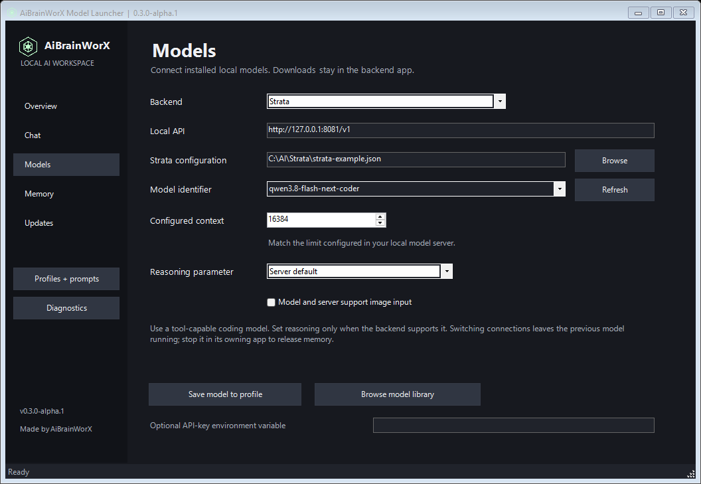
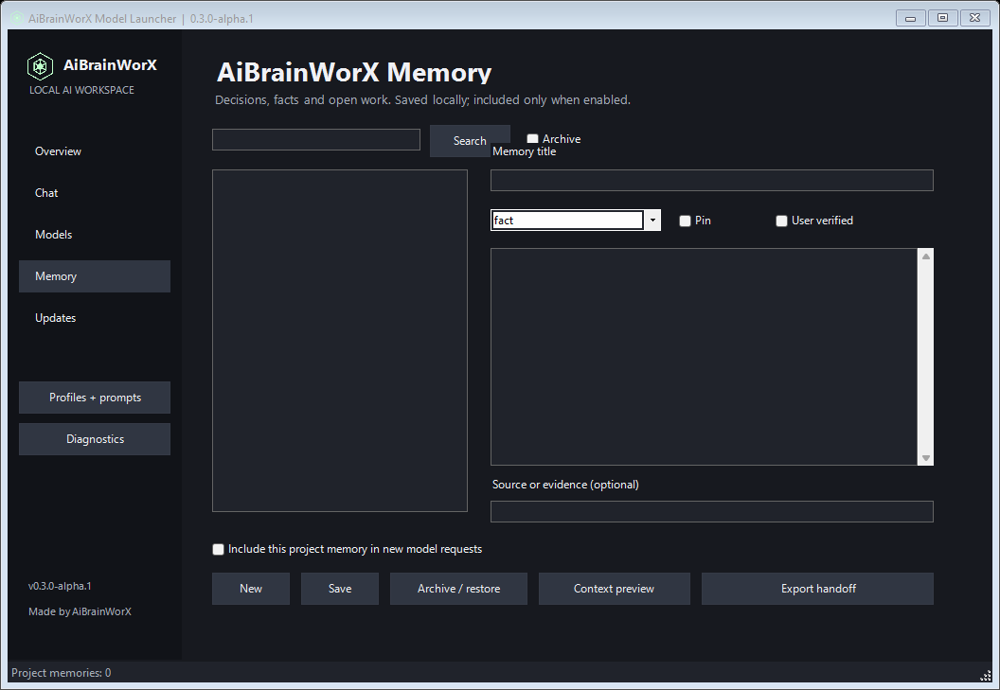

# AiBrainWorX Model Launcher

**Portable local AI for your hardware.** Connect a model, chat, choose a coding client, save instructions and carry project notes across model profiles.

**v0.3.0-alpha.1 · Windows source package · Made by AiBrainWorX**


Download, extract and run from your chosen folder. No fixed launcher installation path or registry registration is required. Python, Node, model servers and weights are separate dependencies. Run **Setup.cmd on each PC**; this is not a standalone executable or a bundle of models.

[Setup article](https://aibrainworx.com/qwen-38-coder-12gb-gpu-ryzen5-strata-codex-unreal/) · [Model library](https://aibrainworx.com/model-library/) · [MIT license](LICENSE) · [Security](SECURITY.md)

## Start without Git commands

1. [Download the ZIP](https://github.com/AiBrainWorXdotCom/AiBrainWorX-Local-AI-Control/archive/refs/heads/main.zip) and extract it into a permanent folder.
2. Double-click **Setup.cmd**. Choose Strata, Ollama, LM Studio or a local llama.cpp / llama-swap server.
3. For Strata, reuse an installation or follow the explicit setup/download prompts. For another backend, install it separately, start its local API and enter an installed model identifier. No Strata installation is needed for those backends.
4. Choose a project folder. Unreal integration is optional.
5. Open **Launch.cmd**. In **Models**, refresh the local inventory and save a connection. Start Strata here, or start other backends in their own app.
6. Open **Chat** for a tool-free conversation. For coding, choose DeepSeek Harness or optional Codex CLI on **Overview**.

Setup offers missing prerequisites from official sources and installs the official client packages into a separate app runtime when approved. Large Strata model downloads need an explicit `DOWNLOAD` confirmation. The tested Coder files alone are approximately 58.4 GB, plus prepared data; other models differ.

## Customize before launch

- **Model profiles:** backend, exact model ID, loopback API, context declaration, image capability and an optional API-key environment-variable name.
- **Instructions:** editable presets for coding, Unreal, review, stories, adventure games, learning and brainstorming.
- **Request controls:** optional temperature/top-p sliders, a 64–65,536-token output cap, and explicit reasoning effort when supported by the model/server. Server default remains available.
- **Local chat:** streamed text, stop reply, new conversation and a draft-memory action. Conversation history stays in app memory; only notes you explicitly save are persisted by this feature.
- **AiBrainWorX Memory:** local project notes, facts, decisions, tasks, pinning, user verification labels, archive/restore, context preview and Markdown handoff export.
- **Updates:** an explicit GitHub version check, including optional prereleases. Review and replace the source package yourself; checking never installs or restarts anything.



The context field describes the backend configuration; it does not resize its cache or reload the model. Image capability updates client configuration; built-in Local chat currently accepts text only. Tool calling, reasoning parameters and API compatibility vary by model and runtime. Chat support alone does not establish suitability as a coding agent.

## Local servers

| Backend | Default API | Lifecycle |
| --- | --- | --- |
| Strata | `http://127.0.0.1:8081/v1` | Start/stop the selected installed configuration |
| Ollama | `http://127.0.0.1:11434/v1` | Start and load in Ollama |
| LM Studio | `http://127.0.0.1:1234/v1` | Start and load in LM Studio |
| llama.cpp / llama-swap | `http://127.0.0.1:8080/v1` | Start and configure separately |

The settings service on **127.0.0.1:8082** forwards Chat Completions and Responses requests to the saved connection. Only loopback HTTP destinations are accepted. Ollama Responses calls must be stateless. Switching connections does not unload the old model; stop it in its owning app to release memory. Incoming client credentials are not forwarded; the service reads a configured environment-variable key instead. Other software on the PC can still access loopback services.

## Small PCs through powerful workstations

The library contains **33 MIT/Apache-2.0 source-model suggestions**, with original creator credit and reviewed source metadata. Read summaries, context limits, licenses and local-use notes inside the launcher or on our site before opening the original card. No catalog button downloads weights.

| Starting point | Models to investigate, not fit guarantees |
| --- | --- |
| CPU / limited GPU memory | Small quantized SmolLM2, Qwen3 0.6B/1.7B or Phi Mini variants |
| More GPU memory / CPU offload | Qwen3 4B/8B, Granite or Mistral 7B variants |
| Large GPU / more RAM | Larger Qwen, Mistral and Mixtral checkpoints |

Choose a quantization your backend explicitly supports. Weights, cache, vision files and other applications consume memory. CPU-only speed and other GPU vendors have not been benchmarked by us. Strata supports its specific architecture; the other backends broaden model choices.

The site also has five clearly labeled research profiles. A server model appearing in an editorial profile is not a desktop compatibility claim or a bundled download. See [model licensing](MODEL-LICENSES.md).

## Performance: measured conditions matter

Our test PC is an **RTX 3060 12 GB, Ryzen 5 5500 and 32 GB RAM**. Four different short prompts on the existing warm Strata engine measured **17.8–20.8 decode tokens/s**, with no cached input in those trials. Each hit its 192-token output cap. Earlier identical-repeat tests reached 30.9 and 36.7 after a 17.4 first request; another earlier desktop request showed 11.8.

These observations do not promise sustained 20–25 tokens/s. Prompt processing, decode, first-token delay and total task time measure different work. The launcher labels active versus last completed readings. [Method, conditions and all results](docs/performance.md).

## Memory, privacy and moving folders



Original **AiBrainWorX Memory** uses Python SQLite, without a hosted service or embedding download. Profiles pointing at the same project folder share notes across models. Inclusion is opt-in; at most six notes and roughly 4,000 characters are added as reference context. Notes may be stale; “user verified” records the user’s judgment.

Memory, prompts and client histories are private local data, not encrypted by the launcher. Archive is reversible, not secure deletion. A handoff contains saved notes, not the whole transcript; review before sharing. Moving a project folder changes its memory identity in this alpha.

Keep the source folder together when moving it. Runtime state lives outside it; client bridge paths regenerate at launch. On another PC, rerun Setup for its dependencies and paths. Never share `config.local.json`, runtime databases, prompts, histories or logs. Model storage can live elsewhere, including a suitable external drive; storage speed affects performance.

Stop Harness before switching profiles or model settings. Existing terminals retain their opened profile. An older owned settings service can be upgraded when idle; the model engine is left running. [Profiles guide](docs/launch-profiles.md).

## Optional Unreal tools

Five fixed inspection operations cover project status, actor list, actor details, editor selection and asset search. The bridge cannot edit or save maps. Four original [Unreal skills](skills/README.md) cover development, source investigation, Epic research and MCP diagnostics. Unreal and its Python plugin are installed separately. See the [setup tutorial](docs/tutorial.md).

## Verification

```powershell
python Tests/test_control_runtime.py
python Tests/test_desktop_features.py
python bridge/test_unreal_mcp.py
powershell -NoProfile -File Tests/Check-Scripts.ps1
powershell -NoProfile -File Tests/Check-ClientLaunch.ps1
python Tests/check_public_files.py
```

Routing, credentials, discovery, streaming, memory, update handling and client preparation have local fake-API contract tests. Live Strata chat returned `PONG` through the new service. Ollama and LM Studio live generation, a fresh-PC bootstrap and live Unreal acceptance have **not** been completed. This remains an alpha source package.

Original launcher, memory, integration code and skills are **MIT**. Models and separately installed tools retain their own terms and attribution. No weights, third-party runtime binaries, OpenHuman implementation or private session files are included. [Third-party notices](THIRD_PARTY_NOTICES.md).
