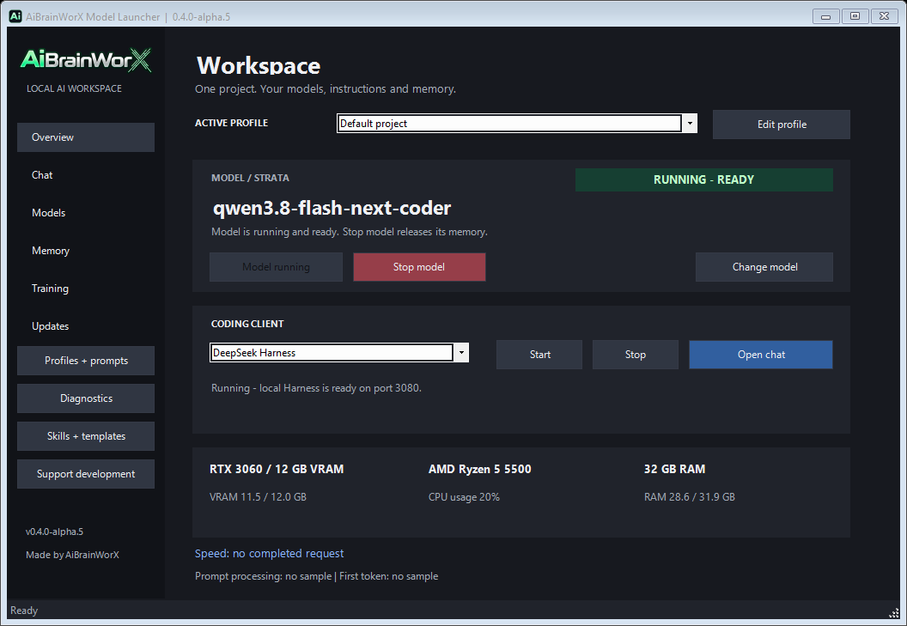
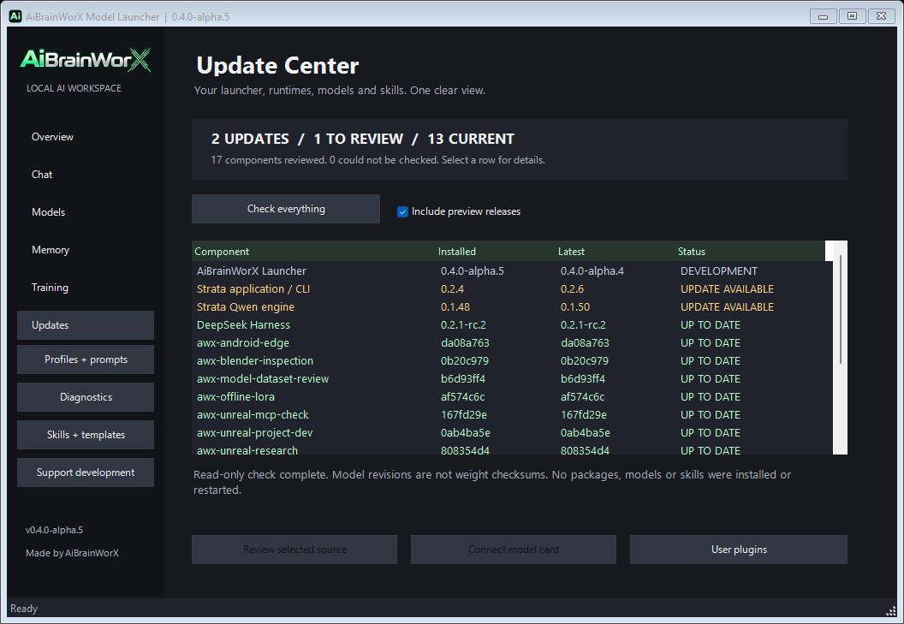
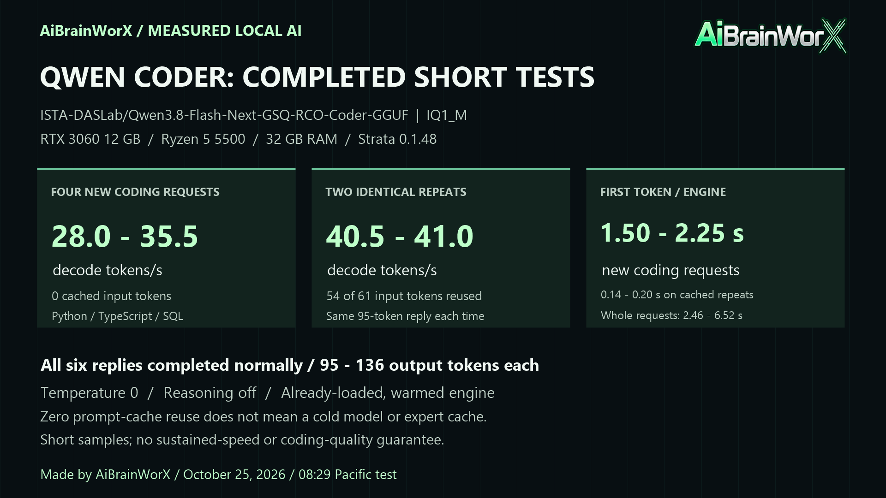

# AiBrainWorX Model Launcher

**Portable local AI for your hardware.** Connect a model, chat, choose a coding client, save instructions and carry project notes across model profiles.

**v0.4.0-alpha.5 · Windows source package · Made by AiBrainWorX**



Download, extract and run from your chosen folder. No fixed launcher installation path or registry registration is required. Python, Node, model servers and weights are separate dependencies. Run **Setup.cmd on each PC**; this is not a standalone executable or a bundle of models.

> **Installation fix — October 26, 2026:** Older ZIPs could mistake Windows' Python Store shortcut for an installed interpreter and fail with “Python was not found.” Download a fresh ZIP for the repaired setup. It verifies Python before using it, finds per-user installations even without PATH, and offers Python installation when needed. [First-time setup and recovery guide](docs/first-run.md).

> **Normal-user follow-up:** Python setup now skips the optional `py.exe` launcher. Repairing an existing shared launcher could request administrator elevation and roll back an otherwise valid per-user install with error **1625**. The interpreter is installed for the current user; setup does not change Windows policies or other users' Python installations.

[Product overview](https://aibrainworx.com/qwen-38-coder-12gb-gpu-ryzen5-strata-codex-unreal/) · [Model library](https://aibrainworx.com/model-library/) · [MIT license](LICENSE) · [Security](SECURITY.md)

## Built with Codex orchestration and local Qwen

AiBrainWorX directs the product. **Codex is our development orchestrator**: it plans changes, coordinates focused reviews, implements integrations, runs checks and prepares GitHub and website updates. The October 25 review session used **GPT-6.1 Sol with Ultra reasoning**, verified from its session configuration.

Our **Qwen3.8-Flash-Next-GSQ-RCO-Coder-GGUF, IQ1_M** also contributes local coding and review through Strata. Suggestions are checked against source and tests before being accepted. Codex development assistance is separate from local inference: measured token speeds come from Qwen, Strata and the test hardware. Codex is optional for people running the launcher.

[Development workflow and responsibilities](docs/development-workflow.md) · [Fresh performance review](docs/reviews/2026-10-25-performance.md)

## Start without Git commands

Start on **64-bit Windows 10/11** with an internet connection for initial dependencies. You do not need a GitHub account, Microsoft account, Unreal Engine or Git commands. A local model server and model are required for chat; they are separate downloads. The tested large Strata preset uses an NVIDIA GPU, 12 GB VRAM, 32 GB RAM and about 120 GB free SSD space; this is **one tested preset**, not the requirement for every smaller model or external backend.

1. [Download the ZIP](https://github.com/AiBrainWorXdotCom/AiBrainWorX-Local-AI-Control/archive/refs/heads/main.zip). In File Explorer, right-click it → **Extract All**. Open the extracted folder containing `Setup.cmd`; do not run from inside the ZIP.
2. Double-click **Setup.cmd**. In **Step 1**, answer `y` to install missing Python / Node.js prerequisites through Windows Package Manager, or follow the printed official manual links. Python must be working **64-bit 3.10+** with SQLite and venv; setup offers Python 3.12. Node.js LTS includes npm. Git is offered only if you choose Strata. Installer dialogs may ask for approval; declined/failed installs stop with recovery instructions.
3. In **Step 2**, choose `1` for Strata, `2` for Ollama, `3` for LM Studio or `4` for a local compatible server. Reuse an existing Strata model or approve its guided setup. Large downloads begin only after you type `DOWNLOAD`. For other backends, install/load the model in that app first, then enter its API address and exact installed model ID.
4. In **Step 3**, approve the official coding-client packages. In **Step 4**, choose a project folder for the assistant to work in. An empty folder is fine. Unreal integration is optional.
5. Wait for **Setup complete**, then double-click **Launch.cmd**. Start the selected Strata model and wait for green **Running**. Other backends are started in their own apps.
6. Open **Chat** to try a message. For coding, choose **DeepSeek Harness** on **Overview**, click **Start**, wait until ready, then **Open chat**. Codex CLI is an alternative client; it is not required to use Harness.

If an installation fails, read the last message, fix that prerequisite and rerun `Setup.cmd`. Existing downloads are retained. [Detailed steps, manual commands, common errors and a no-download prerequisite check](docs/first-run.md).

The model card shows **Stopped**, amber **Starting / Stopping**, and green **Running** states. Start is highlighted when available; Stop becomes active while an owned Strata model starts or runs. Loading does not freeze the window. Other backends remain controlled in their own apps. Shutdown verifies that the captured process tree exited, including when Windows reports a child that already ended.

Setup offers missing prerequisites from official sources and installs the official client packages into a separate app runtime when approved. Large Strata model downloads need an explicit `DOWNLOAD` confirmation. The tested Coder files alone are approximately 58.4 GB, plus prepared data; other models differ.

## Customize before launch

- **Model profiles:** backend, exact model ID, loopback API, context declaration, image capability and an optional API-key environment-variable name.
- **Instructions:** editable presets for coding, Unreal, review, stories, adventure games, learning and brainstorming.
- **Request controls:** optional temperature/top-p sliders, a 64–65,536-token output cap, and explicit reasoning effort when supported by the model/server. Server default remains available.
- **Local chat:** streamed text, stop reply, new conversation and a draft-memory action. Strata/compatible built-in chat saves a full local transcript and can refresh working context behind the same visible conversation. Project memory remains separate; no notes are automatically marked verified.
- **AiBrainWorX Memory:** local project notes, facts, decisions, tasks, pinning, user verification labels, archive/restore, context preview and Markdown handoff export.
- **Update Center:** one read-only check for the launcher, Strata app and matching engine, Harness, recorded model revisions, bundled skills, upstream references and user plugins. Unknown versions remain unverified. Checks never install or restart anything.


The context field describes the backend configuration; it does not resize its cache or reload the model. Image capability updates client configuration; built-in Local chat currently accepts text only. Tool calling, reasoning parameters and API compatibility vary by model and runtime. Chat support alone does not establish suitability as a coding agent.

## Local servers

| Backend | Default API | Lifecycle |
| --- | --- | --- |
| Strata | `http://127.0.0.1:8081/v1` | Start/stop the selected installed configuration |
| Ollama | `http://127.0.0.1:11434/v1` | Start and load in Ollama |
| LM Studio | `http://127.0.0.1:1234/v1` | Start and load in LM Studio |
| llama.cpp / llama-swap | `http://127.0.0.1:8080/v1` | Start and configure separately |

The settings service on **127.0.0.1:8082** forwards Chat Completions and Responses requests to the saved connection. Only loopback HTTP destinations are accepted. Ollama Responses calls must be stateless. Switching connections does not unload the old model; stop it in its owning app to release memory. Incoming client credentials are not forwarded; the service reads a configured environment-variable key instead. Other software on the PC can still access loopback services.

## Long conversations and safe customization

The gateway fits output to the fully rendered prompt and the running server's
context, with a 256-token reserve. Ordinary streamed text can continue twice,
with a 4096-token pass limit and 12,288-token total allocation. Tools, JSON and
Responses are not silently stitched. Strata uses its installed frontend/tokenizer;
llama.cpp Chat Completions uses its native counting APIs. Other connectors retain
their existing cap behavior until exact adapters are validated.

Built-in chat can retain one visible conversation while replacing older working
context with a bounded, unverified handoff. Full transcripts stay in private local
state. Summarization can lose details and costs a model request; saved project
memory remains independent and follows its existing checkbox.

**User plugins** live outside the app installation. Approved API-v1 Python/Node
hooks can extend built-in chat; changed code needs fresh approval. These are
trusted local programs, not sandboxed programs. Voice/audio hooks and a Harness
voice extension are not implemented by this release.

The included `migrate-customizations.py` previews transfers into a separate update
folder. An original shipped baseline enables three-way vendor-file comparison;
conflicting changes require manual review. Applying a plan is a separate explicit
step, with candidate-side backups and no service restarts.



[Context/output safeguards](docs/context-and-output.md) ·
[Update Center](docs/update-center.md) · [Plugins and migration](docs/user-plugins.md)

## Separate Linux edition

[Native Linux / WSL alpha](https://github.com/AiBrainWorXdotCom/AiBrainWorX-Local-AI-Control-Linux) reuses the core with its own browser UI, POSIX process controller and local state. It does not replace this Windows application. See that repository for its exact acceptance limits; Windows benchmark results are not Linux measurements.

## Small PCs through powerful workstations

The library contains **56 model profiles**, including 36 text suggestions, tiny Gemma candidates, TTS, ASR, vision, embeddings and video references, with original creator credit and reviewed source metadata. Read summaries, context limits, licenses and local-use notes inside the launcher or on our site before opening the original card. No catalog button downloads weights.

| Starting point | Models to investigate, not fit guarantees |
| --- | --- |
| CPU / limited GPU memory | Small quantized SmolLM2, Qwen3 0.6B/1.7B or Phi Mini variants |
| More GPU memory / CPU offload | Qwen3 4B/8B, Granite or Mistral 7B variants |
| Large GPU / more RAM | Larger Qwen, Mistral and Mixtral checkpoints |

Choose a quantization your backend explicitly supports. Weights, cache, vision files and other applications consume memory. CPU-only speed and other GPU vendors have not been benchmarked by us. Strata supports its specific architecture; the other backends broaden model choices.

Audio, vision, embeddings and video use dedicated runtimes; cataloguing them does not enable generation in built-in text Chat. Gemma access/terms require separate review and acceptance. The site also has five clearly labeled research profiles. A server model appearing in an editorial profile is not a desktop compatibility claim or a bundled download. See [model licensing](MODEL-LICENSES.md).

## Performance: measured conditions matter

Our test PC is an **RTX 3060 12 GB, Ryzen 5 5500 and 32 GB RAM**. On October 25 at 08:29 Pacific, the already-loaded **Qwen3.8-Flash-Next-GSQ-RCO-Coder-GGUF, IQ1_M**, through Strata 0.1.48, measured **28.0–35.5 decode tokens/s** across four different short coding requests with zero cached input. Two identical repeats reached **40.5 and 41.0**, each reusing 54 input tokens. All six replies completed normally at 95–136 output tokens, with temperature 0 and reasoning off.



First engine token took **1.50–2.25 seconds** on the new requests and **0.14–0.20 seconds** on cached repeats. These were short tests on a warm engine, not a cold-start, sustained-throughput or coding-quality benchmark. No settings were changed for this run, and these numbers do not establish a general speed improvement over earlier tasks. [All six results and latency graphic](docs/benchmarks/2026-10-25-coding-speed.md) · [Method and historical measurements](docs/performance.md).

## Memory, privacy and moving folders


Original **AiBrainWorX Memory** uses Python SQLite, without a hosted service or embedding download. Profiles pointing at the same project folder share notes across models. Inclusion is opt-in; at most six notes and roughly 4,000 characters are added as reference context. Notes may be stale; “user verified” records the user’s judgment.

Memory, prompts and client histories are private local data, not encrypted by the launcher. Archive is reversible, not secure deletion. A handoff contains saved notes, not the whole transcript; review before sharing. Moving a project folder changes its memory identity in this alpha.

Keep the source folder together when moving it. Runtime state lives outside it; client bridge paths regenerate at launch. On another PC, rerun Setup for its dependencies and paths. Never share `config.local.json`, runtime databases, prompts, histories or logs. Model storage can live elsewhere, including a suitable external drive; storage speed affects performance.

Stop Harness before switching profiles or model settings. Existing terminals retain their opened profile. An older owned settings service can be upgraded when idle; the model engine is left running. [Profiles guide](docs/launch-profiles.md).

## Optional Unreal tools

Five fixed inspection operations cover project status, actor list, actor details, editor selection and asset search. The bridge cannot edit or save maps. Eight original [workflow skills](skills/README.md), including four Unreal guides, cover development, source investigation, Epic research and MCP diagnostics. Unreal and its Python plugin are installed separately. See the [setup tutorial](docs/tutorial.md).

## Training, datasets and platform templates


**Training** provides an experimental offline LoRA worker for small floating-point text checkpoints (1.2B stored-tensor cap). Choose local weights, JSONL, a separate training Python and an output folder; preflight and explicitly enable starts per profile. Coding clients receive the same scoped training tools and read-only bundled workflow guides. No live training, dependency install or model download was performed for this update.

The catalog includes six dataset preparation guides. Thirteen saved instruction templates cover coding, creative work, Unreal, tiny Android AI, Blender, LoRA, voice, vision and video/avatar planning. Android and Blender bridges are optional fixed inspection tools; they do not deploy apps, edit scenes or execute arbitrary scripts. Blender is separate from the avatar video workflow.

In **Chat → Open video**, review a completed local MP4 inside the Chat panel using the Windows Media Player component when installed. Play/pause, seek, volume and fullscreen use its native controls. No video is uploaded or sent to the text model. Video model generation is not integrated yet. See [training and platform guide](docs/training-and-platforms.md) and [video workflow](docs/local-video.md).

## Support development

[Support AiBrainWorX on Ko-fi](https://ko-fi.com/aibrainworx). Contributions help fund more hardware coverage, model testing and accessible local-AI tools. The application remains MIT; tips do not buy benchmark claims or favorable reviews.

## Verification

```powershell
python Tests/test_control_runtime.py
python Tests/test_desktop_features.py
python Tests/test_platform_training.py
python bridge/test_unreal_mcp.py
powershell -NoProfile -File Tests/Check-Scripts.ps1
powershell -NoProfile -File Tests/Check-SetupPrerequisites.ps1
powershell -NoProfile -File Tests/Check-ClientLaunch.ps1
powershell -NoProfile -File Tests/Check-ModelLifecycle.ps1
python Tests/check_public_files.py
```

Routing, credentials, discovery, streaming, memory, update handling and client preparation have local fake-API contract tests. Live Strata chat returned `PONG` through the new service. Ollama and LM Studio live generation, a fresh-PC bootstrap and live Unreal acceptance have **not** been completed. The new platform bridges were tested with mocks, not live Blender or physical-device inference. This remains an alpha source package.

The Windows prerequisite regression check executes local fixture programs for the Store alias, invalid/old/32-bit interpreters, Python launcher selectors, paths with spaces, probe timeouts, per-user discovery and successful/failed/declined installation flows. These simulate first-run failures without downloading or installing packages. Real installed-tool checks are also run; this does not claim a complete fresh-PC model download and installation.

Original launcher, memory, integration code and skills are **MIT**. Models and separately installed tools retain their own terms and attribution. No weights, third-party runtime binaries, OpenHuman implementation or private session files are included. [Third-party notices](THIRD_PARTY_NOTICES.md).
