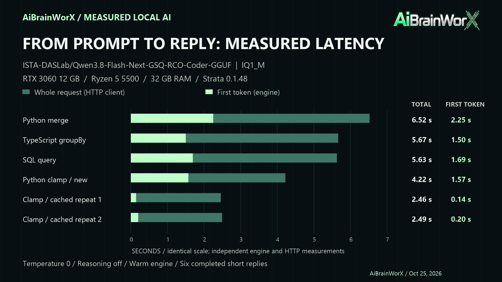

# Strata Coder speed check — October 25, 2026

Test started 08:29:33 Pacific, against the already-loaded engine on this PC.

Exact model: **ISTA-DASLab/Qwen3.8-Flash-Next-GSQ-RCO-Coder-GGUF, IQ1_M**.
Loaded ID: `qwen3.8-flash-next-coder-iq1_m`; requested alias: `qwen3.8-flash-next-coder`.
Engine: Strata 0.1.48. Hardware: RTX 3060 12 GB, Ryzen 5 5500, 32 GB RAM.

| Request | Decode tokens/s | Engine time to first token | Full request | Cached input | Output tokens |
|---|---:|---:|---:|---:|---:|
| New Python merge | 28.0 | 2.250 s | 6.521 s | 0 | 120 |
| New TypeScript groupBy | 32.5 | 1.499 s | 5.665 s | 0 | 136 |
| New SQL query | 28.1 | 1.691 s | 5.627 s | 0 | 112 |
| New Python clamp | 35.5 | 1.570 s | 4.222 s | 0 | 95 |
| Identical clamp repeat 1 | 40.5 | 0.140 s | 2.460 s | 54 | 95 |
| Identical clamp repeat 2 | 41.0 | 0.201 s | 2.494 s | 54 | 95 |

Median of the three varied coding prompts: **28.1 decode tokens/s**.
Their range: **28.0–32.5**. A fourth different short coding request reached **35.5**.

Temperature 0, reasoning explicitly off, sequential direct loopback requests.
No apps closed, saved engine settings changed, services restarted or weights downloaded.
Already-loaded model and warmed expert cache; zero cached input does not mean a cold model load.
Caps were 256 tokens for varied requests and 160 for the repeat sequence. All six finished normally
(`finish_reason=stop`), rather than hitting their caps. The identical responses had matching hashes.

These are short speed samples, not a sustained-throughput or coding-quality benchmark.
Time to first token is Strata's engine measurement, not an independently measured first visible
character in the launcher. Full request time is the HTTP client's measurement.
Final health check confirmed the model remained loaded.

[Numeric observations](2026-10-25-coding-speed.json).
Reproduce the request pattern with [Measure-CoderSpeed.py](../../tools/Measure-CoderSpeed.py).
Rebuild the graphics with `pwsh -File tools/Build-SpeedCheckGraphics.ps1`.

