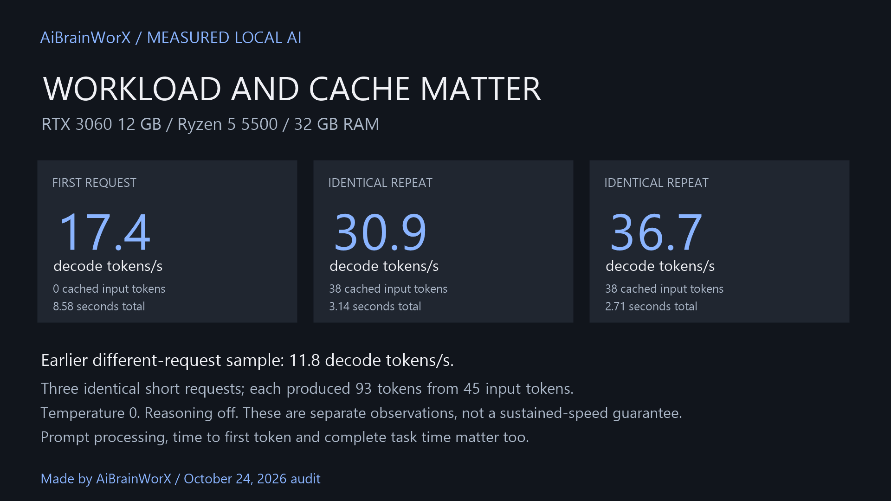
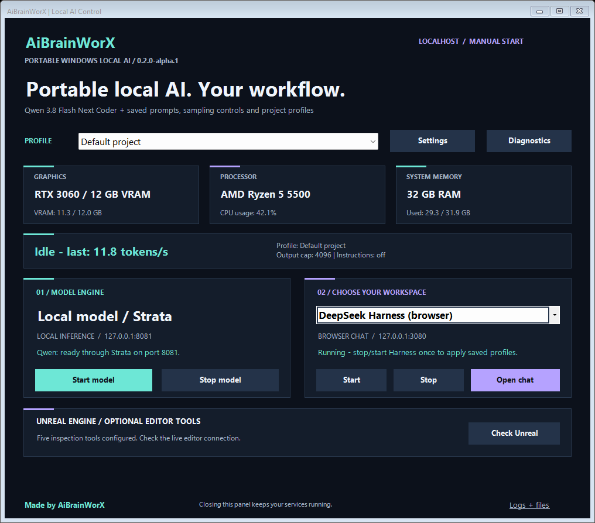
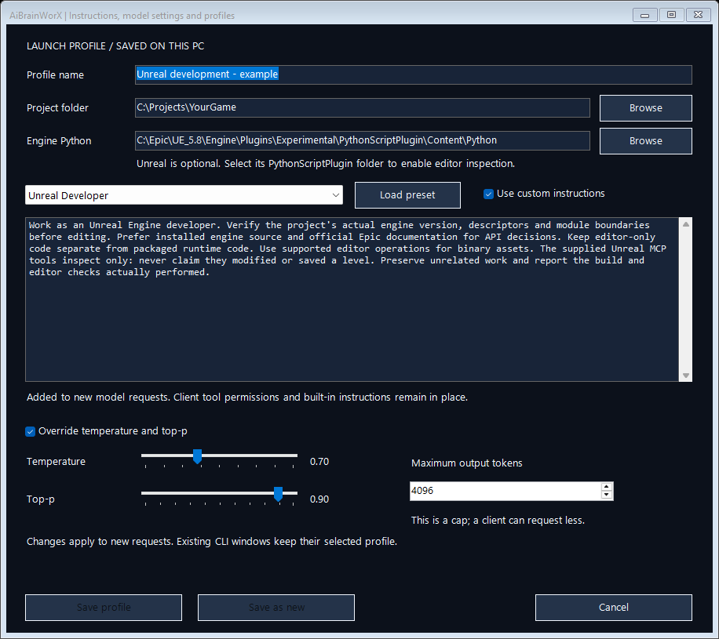
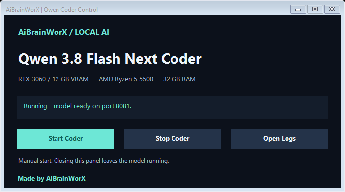

# Qwen 3.8 Coder at 20–25 Tokens/s on a 12 GB GPU and Ryzen 5

*By AiBrainWorX-Ai · October 24, 2026 · Windows tutorial and build diary*

**A 12 GB RTX 3060. An AMD Ryzen 5 5500. Qwen 3.8 Flash Next Coder, running locally and connected to our game-development tools.**

> **Our measured result: about 20–25 generated tokens per second on short local probes.** An RTX 3060 with 12 GB VRAM, an older Ryzen 5 5500, 32 GB RAM and SSD-backed model data made this build possible. These are measurements from our PC, not a speed guarantee; heavy memory pressure with Unreal open reduced one live reading to roughly 13 tokens/s.



That is the machine behind this build. At AiBrainWorX, we connected Strata, Codex CLI, DeepSeek Harness and an Unreal Engine project to make a practical local coding workspace. We also built desktop controls because starting an assistant should be easier than remembering a collection of terminal commands.

Pretty gangsta for an older Ryzen 5 and a 12 GB card.

There is an important engineering detail behind that headline: the GPU works alongside **32 GB of system RAM and an SSD**. The model's roughly 58.4 GB of original files do not all fit into VRAM. Strata spreads the work across the GPU, CPU, RAM and storage. That arrangement makes this setup possible—and memory pressure is also its biggest limitation.



*Our actual Windows launcher. Model inference and the agent interface have separate controls. Made by AiBrainWorX.*

## Portable local AI, with your settings saved

**v0.2.0-alpha.1** adds project profiles, an editable custom-instructions box,
General Coder / Unreal Developer / Code Reviewer presets, temperature and top-p
sliders, and a per-request output cap. Open **Settings**, customize the profile,
and Save before launching your client. Instructions are added to the client's
existing system instructions; tools and client permissions stay in place.



The main panel shows live generated tokens per second plus CPU, VRAM and RAM
readings from Strata. An idle reading is explicitly marked as the last completed
request. Diagnostics checks local connections without generating a reply and
provides a copyable report without personal paths, credentials or prompts.

**Portable means you can extract or move the launcher folder.** There is no
required launcher install directory. Run Setup on each PC to select its own
Python, Node, Strata, model and project locations. Dependencies and model weights
are separate; this is not a standalone EXE or a zero-download model package.
Client bridge paths regenerate from the current launcher location.

The small loopback settings service on port 8082 forwards requests to Strata on
8081. Saved profiles have separate client homes; existing global history is
preserved. Finish active work and Stop → Start Harness once after upgrading.
Stop it before switching project profiles. An open CLI retains its selected
profile. [Read the settings and portability guide](launch-profiles.md).

The following manual configuration examples describe the original direct-to-
Strata setup. The launcher's generated configurations now use the profile URL
on port 8082 and isolated client homes instead of global configuration files.

## What each piece does

**A smaller starting setup is enough:** Strata plus one coding client. Choose Harness for its browser workspace or Codex CLI for a terminal workflow. Our launcher package prepares both for convenience, but you can use just one. The Unreal bridge is optional for people who need editor inspection. This is a flexible development setup, rather than a minimum requirement for running local AI.

The names can make this sound more complicated than it is. Here is the division of work in our installation:

| Component | Its job in this setup |
| --- | --- |
| Qwen 3.8 Flash Next Coder IQ1_M | The local model that generates answers and tool requests. |
| Strata | Loads the model and provides the local inference API. |
| Codex CLI | A terminal coding client configured to use that API. |
| DeepSeek Harness | A browser-based agent workspace using the same Qwen server. |
| Our Unreal MCP bridge | Exposes five bounded editor-inspection tools to the clients. |
| Unreal Engine | Runs the project and supplies live editor information when open. |

**DeepSeek Harness does not mean we are running a DeepSeek model.** In this build, its model provider is Qwen through Strata. Likewise, the Codex CLI local profile sends inference to Strata. This article describes that CLI profile; other Codex app chats can have their own model and provider settings.

The two connections look like this:

```text
INFERENCE
Codex CLI -------------------+
                             +--> Strata :8081 --> local Qwen Coder
DeepSeek Harness :3080 ------+

EDITOR TOOLS
Codex CLI or Harness --> our MCP bridge --> Unreal Python remote execution
```

We run one model server. The clients take turns using it; our Strata configuration allows one request at a time.

## The machine and versions we actually used

| Item | Our installation |
| --- | --- |
| GPU | NVIDIA GeForce RTX 3060, 12 GB VRAM |
| CPU | AMD Ryzen 5 5500, six cores and twelve threads |
| System RAM | Approximately 32 GB |
| Storage | Internal SSD for model files and prepared data |
| Strata engine | 0.1.48 after the update |
| Codex CLI | 0.160.0 |
| DeepSeek Harness | 0.2.1-rc.2 |
| Node.js | 24.13.0 |
| External bridge Python | Python 3.12 |
| Unreal | Our UE 5.8 installation |
| Configured context | 16,384 tokens |
| Vision input | Off for this local model configuration |

Treat this as a versioned account of our build. These projects change quickly, so check the linked documentation when reproducing it with newer releases.

### What if your hardware is different?

Our RTX 3060 and Ryzen 5 describe this build, rather than a universal hardware requirement. The launcher detects the CPU, GPU and system RAM instead of displaying our specifications on every computer.

Run Strata's hardware check before choosing a model. A machine with less memory may need a smaller supported model; a larger GPU can have more room for cached experts. More RAM can reduce competition with the editor, but it does not automatically produce the same speed as another person's benchmark. Supported backends also differ between GPU vendors.

Start with a modest context and one active agent. Measure a real request on your own machine, then adjust through Strata's supported settings. The setup path should reuse an existing installation and let new users choose a model through Strata's installer, with download size and terms shown before large downloads.

## 1. Get Strata working before adding an agent

Our installation uses Strata's source-based Windows setup. The project also offers a newer Terminal installer; its [official setup guide](https://github.com/Niko1221/Strata/blob/v0.2.4/docs/AI_SETUP.md) explains both routes. The commands below describe the source route we used.

Install Git and the prerequisites listed by Strata, then choose an SSD folder with substantial free space. For example:

```powershell
New-Item -ItemType Directory -Path C:\AI -Force
Set-Location C:\AI
git clone https://github.com/Niko1221/Strata.git
Set-Location .\Strata
.\START-HERE.bat --check
```

The model files were about 58.4 GB in our installation. Prepared expert data added approximately 26.6 GB, with additional room needed for the draft layer, engine and installation work. We would allow roughly 120 GB of free SSD space for a reproduction of this particular configuration, rather than budgeting only for the GGUF download.

For the Coder configuration, our selected settings correspond to:

```powershell
.\START-HERE.bat --yes --family coder --model IQ1_M --context 16384 --vision no --host 127.0.0.1 --port 8081 --no-start
```

This downloads and prepares a large model. Let preparation finish before launching another installer or model server. Strata writes a model-specific start script; ours is `run-coder-iq1_m.bat`.

The later engine update reused our existing weights. We verified the release package checksum, its signature and its file hashes, and retained the previous engine for rollback. [Strata release information](https://github.com/Niko1221/Strata/releases/tag/v0.2.4)

## 2. Start one local server and test it directly

Our active inference service listens on:

```text
Server:          http://127.0.0.1:8081
API base:        http://127.0.0.1:8081/v1
Installed model: qwen3.8-flash-next-coder-iq1_m
Client alias:    qwen3.8-flash-next-coder
```

Our configuration also accepts `dronekilla-coder`. These are names for the same loaded model in this installation. Selecting a different alias does not load a faster model.

Start the generated batch file, or use the Qwen control panel we made. Then check readiness:

```powershell
Invoke-RestMethod http://127.0.0.1:8081/health |
    Select-Object service, loaded, model
```

A listening port alone is insufficient. Wait for the model to report loaded, then send a small request:

```powershell
$body = @{
    model = 'qwen3.8-flash-next-coder'
    messages = @(@{
        role = 'user'
        content = 'Write a short Python function that divides a list into chunks.'
    })
    max_tokens = 256
    reasoning_effort = 'none'
} | ConvertTo-Json -Depth 5

Invoke-RestMethod http://127.0.0.1:8081/v1/chat/completions `
    -Method Post -ContentType 'application/json' -Body $body
```

The loopback server in our build requires no inference API key. Keep that assumption tied to this local configuration. An adapter asking for a placeholder key and a server actually enforcing authentication are different settings.



*The smaller Qwen panel controls the existing Strata server. Closing a control window leaves the service running; Stop terminates its active requests.*

## 3. Point Codex CLI at Strata

We used a named local configuration so the ordinary Codex setup could keep its existing defaults. Our installed CLI's help identifies `--profile NAME` as loading a `NAME.config.toml` file from the Codex home directory. Verify that behavior with `codex --help` in the version you install; profile configuration layouts can differ between releases.

In our CLI version, the file is:

```text
%USERPROFILE%\.codex\dronekilla-local.config.toml
```

The important provider settings are:

```toml
model = "qwen3.8-flash-next-coder"
model_provider = "local_strata"
model_context_window = 16384
model_auto_compact_token_limit = 12000
model_reasoning_effort = "medium"
sandbox_mode = "workspace-write"
approval_policy = "on-request"

[model_providers.local_strata]
name = "Local Qwen through Strata"
base_url = "http://127.0.0.1:8081/v1"
wire_api = "responses"
requires_openai_auth = false
stream_idle_timeout_ms = 600000
```

These are the connection essentials, rather than our entire local configuration. Our installation also supplies a custom model catalog describing the alias, text-only capabilities, context limit and coding instructions. The companion files include an adapted catalog and configuration example. Follow the [official custom-provider documentation](https://learn.chatgpt.com/docs/config-file/config-advanced#custom-model-providers) alongside your installed CLI's configuration help.

Start the local profile in the project directory:

```powershell
codex --profile dronekilla-local --cd "C:\Projects\MyUnrealGame"
```

Our launcher checks Strata first and stops with an error if the local service is unavailable. It does not silently request cloud inference. We also give it a project handoff document so it can read current work, test results and unfinished tasks before editing.

## 4. Connect DeepSeek Harness to the same model

The [official Harness repository](https://github.com/deepseek-ai/deepseek-harness) documents the npm entry point:

```powershell
npx @deepseek-ai/dsh web --no-open
```

For a repeatable installation, record the package version you use. Our panel launches the already-installed package directly rather than fetching a new version every time.

The browser service in our build uses `http://127.0.0.1:3080`. Its provider configuration lives in the web profile patch file:

```text
%USERPROFILE%\.dsh\profiles\web\cordis.patch.yml
```

We merged a local provider and default model into that file:

```yaml
- id: llm-pi-ai
  name: "@deepseek-ai/dsh-llm-pi-ai"
  config:
    providers:
      local_strata:
        apiKeyEnv: STRATA_LOCAL_TOKEN
        api: openai-completions
        baseURL: http://127.0.0.1:8081/v1
        models:
          - id: qwen3.8-flash-next-coder
            name: Qwen 3.8 Flash Next Coder
            maxTokens: 4096
            contextWindow: 16384
- id: agent-default-model
  name: "@deepseek-ai/dsh-agent-default-model"
  config:
    provider: local_strata
    model: qwen3.8-flash-next-coder
```

Merge existing entries by their IDs instead of adding duplicate provider blocks. For an adapter that requires a credential environment variable, the local-only example can use a placeholder in the launching terminal:

```powershell
$env:STRATA_LOCAL_TOKEN = 'local-no-auth-required'
npx @deepseek-ai/dsh web --no-open --host 127.0.0.1 --port 3080
```

Our actual provider label is `aibrainworx`, so the selector shows **aibrainworx → qwen3.8-flash-next-coder**.

Harness prints a browser sign-in URL containing a process credential. Our Open chat button opens that URL without displaying its credential in the panel. Keep that URL out of public screenshots and article copy.

## 5. Give both clients an Unreal connection

We built a small custom MCP server shared by Codex and Harness. It exposes:

- `unreal_project_status`
- `unreal_list_actors`
- `unreal_inspect_actor`
- `unreal_get_selection`
- `unreal_find_assets`

The bridge is our own integration, supplied in the companion files. It is not a feature automatically installed by Strata. Its editor calls are read-only: actor transforms, mesh and collision information, current selection, and asset-registry searches. It does not open a map, save a level or write assets.

For editor access, enable the **Python Editor Script Plugin** and **Editor Scripting Utilities** in the project. Our project also has this editor configuration:

```ini
[/Script/PythonScriptPlugin.PythonScriptPluginSettings]
bRemoteExecution=True
RemoteExecutionBindAddress=127.0.0.1
```

Restart the editor after changing plugin settings, once existing work is saved. Epic's [Python editor guide](https://dev.epicgames.com/documentation/en-us/unreal-engine/scripting-the-unreal-editor-using-python) explains the underlying editor scripting support. Our external bridge uses a separate Python installation to communicate with the editor.

For Codex, register the bridge as a stdio MCP server:

```toml
[mcp_servers.unreal_local]
command = "python"
args = ["C:/AI/UnrealAssistant/unreal_mcp.py"]
startup_timeout_sec = 15
tool_timeout_sec = 60

[mcp_servers.unreal_local.env]
UE_PROJECT_ROOT = "C:/Projects/MyUnrealGame"
UE_PROJECT_NAME = "MyUnrealGame"
UE_ENGINE_PYTHON = "C:/Program Files/Epic Games/UE_5.8/Engine/Plugins/Experimental/PythonScriptPlugin/Content/Python"
```

Use the actual Python executable path if `python` is not reliably available to launched applications. The environment fields above belong to the portable companion bridge; our original bridge used installation-specific paths. [Codex stdio MCP configuration](https://learn.chatgpt.com/docs/extend/mcp#stdio-servers)

Harness uses the same bridge through its MCP client plugin:

```yaml
- id: mcp-unreal-local
  name: "@deepseek-ai/dsh-mcp-client"
  config:
    serverName: unreal_local
    transport: stdio
    command: python
    args: ["C:/AI/UnrealAssistant/unreal_mcp.py"]
    env:
      UE_PROJECT_ROOT: "C:/Projects/MyUnrealGame"
      UE_PROJECT_NAME: MyUnrealGame
      UE_ENGINE_PYTHON: "C:/Program Files/Epic Games/UE_5.8/Engine/Plugins/Experimental/PythonScriptPlugin/Content/Python"
    toolCallTimeoutMs: 30000
```

The [Harness MCP client reference](https://github.com/deepseek-ai/deepseek-harness/blob/master/packages/mcp/mcp-client/README.md) documents this registration format. The bridge checks the project identity, bounds query sizes and rejects unsupported operations. Live inspection requires the intended editor to be open; a project-status response reporting a closed editor is not proof of a live connection.

## 6. Use the correct workspace and test a real tool call

In Harness, select the game workspace, create a new session there, and choose **Standard mode**. Begin with **Workspace Write** permissions for scoped coding work.

Our first diagnostic prompt is deliberately small:

> Use the Unreal project-status tool. Tell me whether the editor is connected and report the result. Do not change any files.

When the editor is available, ask for one more bounded operation:

> List up to ten actors in the open level using the Unreal tools. Include their labels and classes.

Seeing a model claim that it can access Unreal is insufficient. Inspect the actual tool call and its returned result. Source-file editing uses the coding client's file tools; changing `.umap` or `.uasset` content requires appropriate Unreal editor operations, which this inspection bridge does not provide.

## The launcher we made

Our AiBrainWorX control panel brings the daily workflow into one window:

1. Click **Start model** and wait for Strata to report ready.
2. Choose **DeepSeek Harness (browser)** in the workspace dropdown, start it, then open chat.
3. Check the Unreal connection when live inspection is needed.
4. Stop the service you are finished using.

The workspace dropdown also offers **Codex CLI (optional)**, which opens the same local model profile in an interactive terminal. Its service buttons are disabled because the terminal controls that client session. The model choice is configured during Setup; the dropdown switches clients, not model weights. The controls are independent. Stopping Harness leaves Qwen running, and the launcher checks process identity before stopping its own services. We tested Harness start, stop and duplicate-start handling. Opening the panel does not start inference automatically.

The refreshed design displays the real hardware, separates model and workspace controls, and carries **Made by AiBrainWorX**. These screenshots show the actual Windows application, not a generated mockup.

## The headline result: 20–25 generated tokens per second

On short probes, we measured about **20–25 generated tokens per second**. One before/after engine comparison recorded 21.5 and 24.8 tokens per second, but total request time was about 11.7 and 12.7 seconds respectively. Different output lengths and prompt-processing time matter; that single comparison does not establish an overall speed improvement.

A small generated Python function passed six edge cases. A separate data-lookup probe returned an incorrect answer. Healthy API responses and impressive token counters do not replace checking the work.

The bigger slowdown arrived with Unreal open. We observed nearly exhausted system RAM, heavy paging, and about a gigabyte of shared GPU memory attributed to Strata. A live generation reading fell to roughly **13 tokens per second**. This is why we do not present the setup as a proven high-performance simultaneous workflow for a large model and a heavy Unreal scene on 32 GB of RAM.

For model testing, save work and close GPU-heavy applications. For an editor session, use the Stop Qwen control when the model is not needed. Keeping both active reliably needs an appropriate memory budget, a smaller model or more hardware headroom; our concurrent memory tuning remains unfinished.

## Three problems worth recognizing early

**The reply reaches its output limit.** Harness can stop a turn after consuming its output budget, including reasoning. Keep requests focused and inspect the trajectory. Any larger output allowance must still fit the model's total context. We observed this issue; it was not resolved merely by choosing another alias.

**The assistant works in the wrong folder.** A session under Default workspace is not automatically a session in the game project. Select the intended workspace before starting the task.

**The engine update or a process restart appears to fix everything.** Confirm generation and tool calling separately. Our earlier local Codex tests verified model generation and a project-status tool round-trip. Harness registration and service lifecycle were checked later. Live actor, asset and selection inspection should be verified against an open editor rather than inferred from those other successes.

## Bonus: four portable Unreal skills

We also prepared an **AiBrainWorX Unreal skills pack** for the companion repository. It gives a coding assistant repeatable engineering workflows alongside the actual tools. The starting target is UE 5.8, and each workflow checks the project's installed engine rather than assuming every Unreal version has identical APIs.

| Skill | What it helps with |
| --- | --- |
| `awx-unreal-project-dev` | Make focused project and plugin changes, checking module boundaries, reflection and the affected build target. |
| `awx-unreal-source` | Trace errors through project descriptors, build rules, configuration and available engine source. |
| `awx-unreal-research` | Find version-specific Epic documentation and distinguish official guidance from forum observations. |
| `awx-unreal-mcp-check` | Check the Python plugins, client registration, project identity and live inspection connection used in this tutorial. |

For Codex, copy each desired skill folder from the repository's `skills` directory into your own skills directory, normally `%USERPROFILE%/.codex/skills/`. Keep its `SKILL.md` inside the named folder, compare before replacing an existing skill, and start a new session after installation. A direct first request is:

> Use $awx-unreal-mcp-check to inspect my Unreal connection. Report what is connected and what still needs testing. Do not change the project.

**Skills provide guidance; MCP provides tools.** Installing the Markdown does not install Unreal, enable plugins, register a server, grant file access or turn inspection tools into editing tools. Complete the connection setup above first. Other coding assistants may use the same instructions, but their skill-loading mechanisms differ; automatic discovery is not assumed.

These are our original MIT-licensed instructions. They contain no Epic engine code, Marketplace assets, model weights or private game files. Their structure and portability have been checked, while behavioral validation in a fresh user installation remains a separate acceptance step. The launcher, four skills and setup examples are available in the [public companion repository](https://github.com/AiBrainWorXdotCom/AiBrainWorX-Local-AI-Control). [Download the ZIP](https://github.com/AiBrainWorXdotCom/AiBrainWorX-Local-AI-Control/archive/refs/heads/main.zip), extract it, read the model license notes, and run Setup.cmd.

## A useful local assistant on hardware we already owned

The achievement is concrete: **Qwen 3.8 Flash Next Coder running locally on an RTX 3060 and Ryzen 5 5500, with Codex CLI, a browser agent workspace and a shared Unreal inspection bridge.**

There is room to improve the memory budget, reasoning settings and live-editor validation. The foundation is working, the controls are easier to use, and the measurements make the next improvements clear.

**Made by AiBrainWorX.**

*Companion files: the launcher, portable configuration examples, our read-only Unreal bridge, its contract tests, four Unreal skills, and setup notes. They contain no model weights, private game assets or credentials.*

### License notes for the GitHub package

AiBrainWorX's original launcher and integration code use the **MIT license**. The other projects keep their own licenses: [Strata is MIT](https://github.com/Niko1221/Strata/blob/v0.2.4/LICENSE), [DeepSeek Harness is MIT](https://github.com/deepseek-ai/deepseek-harness/blob/master/LICENSE), and [Codex CLI is Apache 2.0](https://github.com/openai/codex/blob/main/LICENSE). Codex CLI source can be forked under that license; this does not supply OpenAI's proprietary models or desktop application.

For the exact Qwen variant, the [quantized model card](https://huggingface.co/ISTA-DASLab/Qwen3.8-Flash-Next-GSQ-RCO-Coder-GGUF) declares Apache 2.0, while the [upstream Qwen license](https://huggingface.co/Qwen/Qwen3.8-Flash-Next/blob/main/LICENSE) is Qwen Community License 1.0 and includes conditions affecting commercial coding-assistant businesses. That mismatch needs clarification for redistribution or commercial plans. Our package does not relicense or bundle the weights, and a download link does not remove their applicable terms. Unreal is also a separately installed product under Epic's terms.
